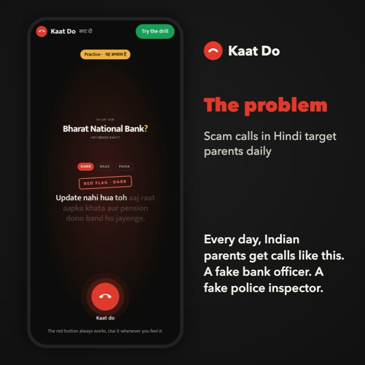

# Kaat Do · काट दो

**A fire drill for scam calls.** Kaat Do phones your parents with practice scam calls in Hinglish, listens to how they answer, and coaches them afterwards, optionally in your own cloned voice, so the first scam they face is not the real one.

**Live demo:** https://kaat-do.vercel.app · **Straight into a drill:** https://kaat-do.vercel.app/try

### Demo video

[](docs/kaat-do-demo.mp4)


https://github.com/user-attachments/assets/fcc44397-18de-4996-9b81-c32f08941c20


**[▶ Watch the demo (MP4, 1:1)](docs/kaat-do-demo.mp4)**. GitHub opens the file in its own player.

Built for Gnani AI's Great Indian AI Internship Challenge on three Gnani models: **Prisma** (speech to text), **Timbre** (text to speech) and **voice cloning**. Synthetic data only.

---

## The idea in one rule

> **Darr, Raaz, Paisa. Kaat do.**
> Fear, secrecy or money: if even one shows up, hang up. Then call family, or the cyber crime helpline **1930**.

A drill of only scams teaches people to cut everything, so one of the three calls is **genuine**. The parent has to tell them apart.

| Call | Who | Red flags | Right move |
| - | - | - | - |
| Bank KYC | "Bharat National Bank" agent; a fake OTP SMS arrives mid-call | Darr, Paisa | Cut at the threat |
| Courier | "Speedline Courier", a real-sounding delivery call | none | Listen and answer |
| Digital arrest | "Customs", then a shouting "Inspector Rathore" | Darr, Raaz, Paisa | Cut at the transfer or the threat |
| Your voice *(optional)* | Your cloned voice from a "new number", asking for money | Paisa, Raaz | Cut, then call your real number |

The result is a verdict, not a score: **Pakka** (every scam cut, the genuine call kept), **Bach gaye** (safe, with a slip on the way) or **Phans gaye** (an OTP given or a scam call ran to its end). Each call is drawn as a strip of its stages with a cut line where the parent hung up, and every slip is shown with the words Prisma actually heard.

## How it uses Gnani

| Model | Job | When it runs |
| - | - | - |
| **Prisma v3.0** (`/stt/v3`, `hi-IN,en-IN`, `format=transcribe`) | Hears every reply the parent speaks, in Hindi, English or both. Also checks the consent sentence before any cloning | Live: one short request per turn |
| **Timbre v2.5 / v3.0** (`/api/v1/tts/inference`) | Every caller voice, rendered at 8 kHz so it sounds like a phone line. v3.0 audio tags (`<shouting>`, `<sigh>`) for the "inspector" | Once, at build time (47 clips in `web/audio/`) |
| **Voice cloning** (`/api/v1/tts/voice-clone/embeddings` + `vachana-vc-v1`) | The fourth call and the debrief in the child's voice, ending with the reveal that it was AI | Once per personalised drill |

Nothing is synthesised while a parent is on a call, so a turn costs one short transcription (median about 0.2 to 0.4 s in testing) and the caller answers without the pause that gives most AI calls away.

### Reply sorting

`api/sort.py` turns each Prisma transcript into one of six kinds, in this order: **hang up**, **gave the OTP**, **will verify**, **pushed back**, **agreed**, **unclear**. It handles Devanagari, Latin and mixed script, and maps spoken numbers ("chaar aath do nau", "four eight two nine", "double saat") to digits. The OTP counts only as an exact, in-order match of all six digits, and the OTP is never sent to Prisma as a hint. An unclear reply never counts as a slip. No outside LLM is used.

Measured on ten test replies through the live settings: 10/10 sorted correctly, including the OTP said three ways. These were synthetic voices, so treat it as a design check, not a field result.

## Architecture

```
Browser (phone first, plain JS)                     Server (FastAPI, Vercel Python function)
───────────────────────────────                     ──────────────────────────────────────────
landing/index.html   landing page + live "Talk back" demo
web/index.html       the drill: ring, call, SMS, debrief, result card
  call.js            call state machine (all call state lives in the page)
  mic.js             Web Audio capture, pause detection, 16 kHz WAV
  card.js            verdict, stage strips, debrief voice note
web/setup.html       record consent, make a drill in your voice
        │
        │  POST /api/turn  (WAV + fake OTP)  ───────►  api/app.py ──► api/gnani.py ──► Gnani Prisma
        │  ◄──── transcript + reply kind               api/sort.py   (queued client, key server-side)
        │
        │  POST /api/drill, /api/drill/{id}/clip/{n} ►  consent check (Prisma) → embedding → cloned clips
        │  GET  /audio/*.mp3  ◄─────────────────────    pre-rendered Timbre caller lines
```

The Gnani key lives only on the server. The browser builds the WAV itself because Prisma REST does not accept the WebM/MP4 that browsers record. The microphone is closed while the caller speaks (half duplex), so the caller's voice is never transcribed as the parent's.

## Repository layout

| Path | Holds |
| - | - |
| `scripts/calls.json` | Every call, stage, line, pressure line, nudge, debrief line and the consent sentence, as data |
| `api/app.py` | Routes: `/` (landing), `/try`, `/setup`, `/api/script`, `/api/turn`, `/api/drill`, `/api/result`, `/r/{id}` |
| `api/gnani.py` | One queued Gnani client: retry once, 402/429 fall back to tap mode |
| `api/sort.py` | Number words to digits, exact OTP match, reply kinds |
| `api/index.py`, `vercel.json` | Vercel entry point |
| `web/` | The drill, setup page, styles, pre-rendered audio and demo replies |
| `landing/index.html` | The landing page (`index.html` at the root is the same page for GitHub Pages) |
| `tools/render_stock.py` | Renders the caller lines with Timbre |
| `tools/gate1.py` | Runs recorded replies through Prisma in both formats, and makes a clone sample |
| `tests/test_sort.py` | OTP forms, agree, push back, verify, hang-up words (36 tests) |

## Run it locally

```bash
python3 -m venv .venv && .venv/bin/pip install -r requirements.txt
cp .env.example .env          # then put your Gnani key in .env as GNANI_API_KEY=...
.venv/bin/python -m pytest -q tests
.venv/bin/uvicorn api.app:app --port 8000
```

Open http://localhost:8000 for the landing page, http://localhost:8000/try for the drill (add `?captions=1` to show both sides as text for filming) and http://localhost:8000/setup to make a drill in your voice. The caller audio is already in `web/audio/`; re-render it with `.venv/bin/python -m tools.render_stock --force` after editing `scripts/calls.json`.

A phone needs HTTPS for the microphone, so test phones against the deployed site or an HTTPS tunnel. Without a key, or with the microphone refused, the drill runs in **tap mode** with large reply buttons.

**Deploy:** `vercel deploy --prod --yes` from the repo root, with `GNANI_API_KEY` set as a Vercel environment variable.

## Safety rules the build follows

- Every screen says **Practice**. The red button always works. No accident, kidnap or death scripts.
- All banks, couriers and officers are fictional. The only OTP is a fake one shown on screen. No real phone, account, Aadhaar or PAN numbers.
- The cloned voice speaks only fixed script lines, with one slot for Papa / Mummy / Dada / Nani. There is no free-text box.
- The consent sentence is recorded live and Prisma must hear it before an embedding is made. The clip is not kept.
- Reply audio is discarded after transcription. Only the verdict and slip lines are stored. Cloned voices are deleted after seven days.
- The API key and voice embeddings never reach the browser.

## Known limits

- One drill does not prove a habit, and nothing here proves a fraud was prevented.
- The live app hears a browser microphone, not a phone line. Parents without a smartphone are not reached.
- On Vercel's free tier, files written by one request may not be there for the next, so a personalised drill link made at `/setup` can expire before it is opened. Run personalised drills from a server with a persistent disk (the `Dockerfile` works on any container host).
- Evon (Gnani's reasoning model) is not on the public API, so reply sorting is rules in code.

## Settings (`.env`)

| Variable | Default | Does |
| - | - | - |
| `GNANI_API_KEY` | (required) | Your Gnani key |
| `CLONE_CALL_ENABLED` | `1` | `0` drops the fourth call in the child's voice; the debrief and reveal stay |
| `CLONE_ENABLED` | `1` | `0` turns off personalised drills |
| `MAX_CLONE_DRILLS` | `40` | Credit floor: new personalised drills stop after this many |
| `STT_FORMAT` | `transcribe` | Or `transliterate` |
| `GNANI_CONCURRENCY` | `1` | Parallel Gnani requests per server instance |

---

Made by [@Adi-o-s](https://github.com/Adi-o-s). Got a real scam call? Hang up and dial **1930**, or report it at [cybercrime.gov.in](https://cybercrime.gov.in).
